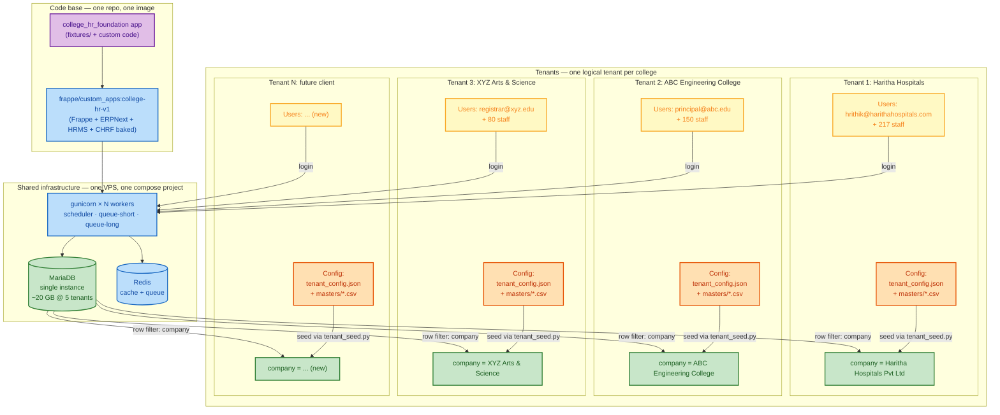
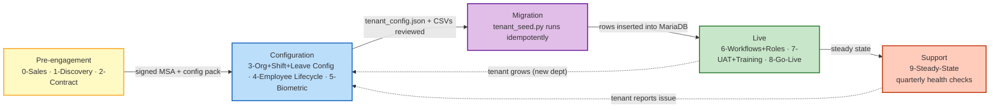
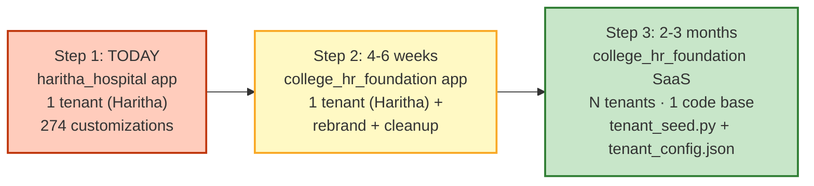

# 02 — Multi-Tenant Architecture (SaaS model)

**Audience:** Venkat, implementation engineers, anyone evaluating the platform for a new college.
**Goal:** Document the SaaS abstraction — one code base, N colleges, isolated data, per-tenant config.
**Status:** ✅ First draft (2026-10-15). Decision: **shared DB with `company` field** (rationale below).
**Next step:** Get Venkat's sign-off on tenant-isolation strategy; then build the `tenant_seed.py` runtime.

---

## What this is

This doc answers the question every new prospect asks: *"If I sign up for College HR Foundation, where does my data live? Who else can see it? What happens if another college churns?"* It defines the **tenant model** for the platform and documents the trade-off we made when choosing shared-DB vs. database-per-tenant.

## Who reads it

| Role | Why they read it |
|---|---|
| **Venkat** (founder) | Validates the cost/ops trade-off before committing to a tenancy model |
| **Sales / Pre-sales** | Answers "is my data isolated?" in college meetings |
| **Implementation engineer** | Knows which config file / where to look when onboarding |
| **Dev / SRE** | Understands backup + restore per-tenant + scaling constraints |
| **Compliance / Legal** (future) | Maps to data-residency + GDPR/DPDP obligations |

---

## Problem statement (one paragraph)

The Haritha Hospitals deploy is a **single-tenant install** of the `haritha_hospital` custom app on a single MariaDB. That model is fine when you have one customer — but College HR Foundation is a **SaaS** where one codebase must serve **N colleges**, each with their own org chart, shifts, holiday list, approver chain, and (potentially) custom fields. The platform must isolate tenant data so a college never sees another college's employees, while still being cheap to operate (one MariaDB, one gunicorn pool, one set of workers) and easy to update (one `bench update` ships the new version to all tenants).

---

## Tenant model — visual

**Key invariants:**
- One code base, one Docker image, one MariaDB, one Redis — deployed once.
- Each tenant is a `Company` row in the shared DB; every Employee/Department/Shift Type/etc. has a `company` Link field.
- Each tenant gets a `tenant_config.json` (git-tracked) + `masters/*.csv` (git-tracked) — these are the **only per-tenant inputs** to `tenant_seed.py`.
- Row-level isolation is enforced by:
  1. **Frappe's built-in company permissions** (HRMS Role Permission Manager: HR Manager sees all companies; HR User scoped per company)
  2. **User Permission** rules scoped to `Employee == self.employee_id` (so any user only sees their own row)
  3. **Department-scoped permissions** for Leave Approver / Roster Manager (already implemented at Haritha — re-runnable per tenant)

---

## Data flow — Discovery → Config → Migration → Live → Support

**Loop semantics:**
- Phases 0–2 are **pre-engagement** (sales, discovery, contract) — Venkat or sales engineer.
- Phases 3–5 are **configuration** (org chart, shifts, leaves, biometric mapping) — implementation engineer.
- Phase 6 is **migration** (the one-time `tenant_seed.py` run).
- Phases 7–8 are **live** (workflows enabled, UAT, training, go-live).
- Phase 9 is **steady-state support** — quarterly health checks, issue triage.
- The dotted lines from Live and Support back to Configuration are intentional: **tenants grow** (new departments, new shifts, new approvers) — the seed script is idempotent, so re-runs are safe.

---

## Tenant config — what lives in `tenant_config.json` (vs. what's code)

| Layer | Lives in | Versioned in git? | Re-runnable? | Example |
|---|---|---|---|---|
| **App code** (custom fields, workflows, roles, server scripts) | `college_hr_foundation` app | ✅ | ✅ (`bench migrate`) | `apps/college_hr_foundation/fixtures/custom_field.json` |
| **Tenant config** (company name, branches, dept list, role-profile names) | `tenants/<tenant_slug>/tenant_config.json` | ✅ | ✅ (`tenant_seed.py`) | `tenants/haritha/tenant_config.json` |
| **Tenant data** (employees, shift assignments, leave allocations) | `tenants/<tenant_slug>/masters/*.csv` | ✅ | ✅ (`migrate_master_data.py`) | `tenants/haritha/masters/employee.csv` |
| **Runtime data** (live check-ins, attendance, leave ledger) | MariaDB (live, not in git) | ❌ | n/a | `tabEmployee Checkin` rows |
| **Per-tenant print formats / letterheads** | DB (`tabPrint Format` / `tabLetter Head`) — **not in git** for the SaaS | ❌ | n/a | Letterhead uploaded via UI by tenant admin |

**Key principle:** anything that changes between tenants lives in **git-tracked config/data files**; anything that's identical across tenants lives in **the app code**. The `tenant_seed.py` script is the runtime that turns git-tracked config into live DB rows.

---

## Decision rationale — shared DB vs. one DB per tenant

This is the **most important architectural call** for the SaaS. We chose **shared DB with `company` field**. Here's the trade-off:

| Criterion | Shared DB (chosen) | One DB per tenant | One schema per tenant (middle ground) |
|---|---|---|---|
| **MariaDB count** | 1 (shared) | N (one per tenant) | 1 server, N schemas |
| **Disk usage** at 10 tenants @ 250 employees each | ~20 GB total | ~2 GB × 10 = 20 GB (same) | ~2 GB × 10 = 20 GB (same) |
| **MariaDB cost** | 1 × small VPS | 1 × medium VPS (more RAM) | 1 × medium VPS (more RAM) |
| **App server** (gunicorn) | 1 × small (8 GB) | 1 × small per tenant (or shared) | 1 × small (shared) |
| **Isolation (data)** | ⚠️ Logical only (company filter) | ✅ Physical (separate DB) | ✅ Schema-level |
| **Cross-tenant analytics** | ✅ Trivial (single query) | ❌ Cross-DB UNIONs | ⚠️ Cross-schema queries |
| **Per-tenant backup** | ⚠️ Logical only (mysqldump + filter by company) | ✅ Trivial (dump single DB) | ✅ Per schema |
| **Restore single tenant** | ⚠️ Restore whole DB + apply forward | ✅ Trivial (restore single DB) | ⚠️ Restore single schema |
| **Per-tenant schema migration** | ✅ `bench migrate` once | ❌ Migrate N DBs (orchestration) | ⚠️ Migrate N schemas |
| **Per-tenant customizations** (client adds a CF) | ✅ Add to fixtures (affects all) | ⚠️ Per-DB fixtures | ⚠️ Per-schema fixtures |
| **Cost @ 5 tenants** | ~$40/mo (1 VPS) | ~$120/mo (1 medium VPS + 5 small DB VPS) | ~$80/mo (1 medium VPS) |
| **Cost @ 20 tenants** | ~$60/mo (scale up VPS) | ~$400/mo (1 large VPS + 20 DB containers) | ~$200/mo (1 large VPS) |
| **Operational complexity** | ✅ Low (1 stack) | ❌ High (N stacks to monitor, patch, back up) | ⚠️ Medium (orchestration) |
| **Tenant leaves the platform** | ⚠️ `mysqldump` filtered by company, restore elsewhere | ✅ Trivial (full DB copy) | ⚠️ Schema dump |
| **Compliance (GDPR / DPDP)** | ⚠️ Single point of failure; need strong encryption + audit | ✅ Easier argument (data lives in isolation) | ⚠️ Same as shared |
| **Best for** | **Multi-tenant SaaS with uniform feature set** | Regulated industries (healthcare, finance) | Hybrid (rare) |

### Why we chose shared DB

1. **Cost at scale:** 20 tenants on shared DB ≈ $60/mo; on per-tenant DB ≈ $400/mo. The 6× cost difference matters in early-stage SaaS where margins are thin.
2. **Operational simplicity:** one `bench update`, one `bench migrate`, one backup cron, one set of workers to monitor. Operations is 1 person (Venkat or 1 SRE), not 3.
3. **Cross-tenant analytics are useful** for the SaaS operator (e.g., "average leave utilization across all colleges" is a sales-engineering data point).
4. **HRMS already uses `company` as a first-class field** — every Employee, Department, Shift Type, Leave Allocation, Attendance already has a `company` Link. Isolation at the application layer is mostly free.
5. **RBAC is already scoped per-company** in Haritha's design — Phase A gave HR Manager org-wide access and HR User / Leave Approver / Roster Manager / Employee scoped access. This same pattern applies per-tenant in the SaaS.

### When we'd revisit

- A college signs an MSA requiring **physical data isolation** (some government / defense clients in India do this). → switch them to a dedicated DB.
- A regulator requires **data residency in India** (already in India for now, but if a global college signs up, may need EU/US region). → per-region DB cluster.
- **Tenant count exceeds ~30 with >500 employees each** → at that scale, query performance on a single DB may degrade. Re-evaluate.

---

## Migration path — current state → SaaS model (3 steps)

### Step 1 — TODAY (single tenant, Haritha-only) — ✅ done

- `haritha_hospital` custom app on `pberpprod` (and dev/qa mirrors).
- 1 tenant: Haritha Hospitals.
- 274 customizations + 2 workflows + 6 role profiles + 6 workspaces.
- Migration script: `migrate_master_data.py` (16 DocTypes, idempotent).
- Custom image: `frappe/custom_apps:version-16` (HRMS + haritha_hospital baked).

### Step 2 — NEXT (4–6 weeks): extract the reusable parts → `college_hr_foundation` app

| Sub-step | Effort | Owner | Output |
|---|---|---|---|
| 2.1 — Fork `haritha_hospital` → new repo `college_hr_foundation` | 0.5 day | dev | New repo, no code change |
| 2.2 — Remove 6 Haritha-specific fixtures (`is_emergency` CF + 2 letterheads + 3 print formats + role-profile prefix) | 0.5 day | dev | 276 reusable fixtures |
| 2.3 — Rename role profiles `Haritha:` → `CHRF:` (or `College HR:`) | 0.5 day | dev | Renamed 6 RPs |
| 2.4 — Rewrite `migrate_master_data.py` → `tenant_seed.py` (takes `tenant_config.json` + `masters/*.csv`, idempotent, parameterized by tenant_slug) | 2 days | dev | Tenant-seed script |
| 2.5 — Test on `pberpdev` with a fictional "Test College" data set | 1 day | dev + Venkat | Test report |
| 2.6 — Re-install on `pberpprod` as a **rename + reinstall** (drop `haritha_hospital`, install `college_hr_foundation`, re-run `tenant_seed.py --tenant=haritha`) | 0.5 day | Venkat | Haritha on new app |
| 2.7 — Cut a tag `college-hr-v1.0.0` and rebuild custom image `frappe/custom_apps:college-hr-v1` | 0.5 day | dev | New image |

### Step 3 — 2–3 months: SaaS for colleges

| Sub-step | Effort | Owner | Output |
|---|---|---|---|
| 3.1 — Build `tenant_config.json` schema + a `config-validator` (CLI that checks required fields, no missing references) | 3 days | dev | Validator |
| 3.2 — Build `tenants/<slug>/` repo structure + a `tenant_clone` CLI (copy `tenants/_template/` → `tenants/<new_slug>/`) | 1 day | dev | Onboarding CLI |
| 3.3 — Build a small "tenant admin" web UI inside the app (for college HR Head to upload their letterhead, edit their Holiday List, etc.) | 1 week | dev | Tenant admin SPA |
| 3.4 — Build per-tenant backup (`mysqldump` filtered by `company`) + restore CLI | 3 days | dev | Per-tenant DR |
| 3.5 — Pilot with 1 college (e.g., a friendly contact in Venkat's network) — end-to-end 9-phase methodology | 6–8 weeks | Venkat + dev | First paying tenant |
| 3.6 — Iterate on `tenant_seed.py` based on pilot feedback | 2 weeks | dev | v1.1 |

**Total elapsed time to SaaS-ready:** ~4 months (Venkat 1 day/week + dev 50% time).

---

## Data gaps

| Gap | Detail | Resolution |
|---|---|---|
| Multi-company isolation **not yet tested** at Haritha | Haritha has 1 `Company` row today. Frappe's per-company permissions are configured but never exercised in a multi-company setup | Step 2.5: spin up a second Company on `pberpdev`, verify HR User cannot see Company-A's employees |
| Per-tenant backup script | Doesn't exist yet (current cron backs up the whole DB) | Step 3.4 |
| Tenant admin UI | Doesn't exist — for now, Venkat runs `tenant_seed.py` over SSH | Step 3.3 |
| SMTP per tenant | Not configured (Phase D D6) — when added, each tenant needs its own Email Account | Discovery checklist item — capture SMTP creds in `tenant_config.json` |
| Compliance review (DPDP Act 2023) | Not done for India-specific data protection obligations | Before signing first college — engage counsel |

---

## Next steps

1. **Sign-off on shared-DB decision** — Venkat to confirm before dev work starts in Step 2.
2. **Decide the SaaS domain** — `college-hr-foundation.com`? `processbricks.io/hr`? Pick before Step 2.3 (role-profile prefix).
3. **Pick tenant-config schema** — what fields go in `tenant_config.json`? Draft from this doc, circulate to dev.
4. **Build `tenant_seed.py`** — the runtime that turns config into DB rows.
5. **Pilot college identification** — pick the first friendly college; schedule a Discovery call.
6. **Per-tenant backup design** — `mysqldump --where='company=...'` is the simple answer; document the restore procedure before pilot.

---

*See also: `01-stock-frappe-hr-vs-custom.md` (what's in the app), `03-data-flow-discovery-to-live.md` (the 9-phase onboarding methodology).*
