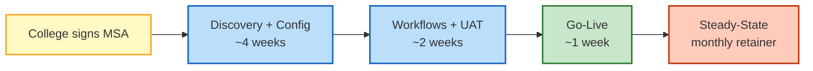

# 03 — Data Flow: Discovery → Live (the 9-phase methodology)

**Audience:** Implementation engineers, sales engineers, and Venkat when scoping a new college engagement.
**Goal:** One picture of the entire 9-phase onboarding methodology — input, activity, output, templates, time estimate, for every phase.
**Status:** ✅ First draft (2026-10-15). Based on Haritha Hospitals engagement (the reference deploy) + generalization to college SaaS.
**Next step:** Validate the time estimates after the first pilot college; update the doc with actuals.

---

## What this is

This doc is the **"how do we onboard a new college"** answer in a single image. It enumerates 9 phases from the first sales call to steady-state support, with the inputs (what the college gives us), activities (what we do), outputs (what we deliver), and templates (the reusable artifacts) for each phase. It is the implementation playbook that any new engineer or sales engineer can read top-to-bottom and understand the full engagement lifecycle.

## Who reads it

| Role | Why they read it |
|---|---|
| **Sales engineer** | SOW scoping — "how many weeks per phase for a 200-employee college?" |
| **Implementation engineer** | Day-to-day work — "what's the next step after the contract is signed?" |
| **Venkat** | Engagement health check — "where are we in this engagement? what's at risk?" |
| **Client (college HR Head)** | Onboarding reference — "what do I need to prepare for next week?" |

---

## The 9 phases — one image

```mermaid
flowchart TB
    P0["Phase 0<br/>SALES<br/><i>demo + scope</i><br/>3-5 days"]:::pre
    P1["Phase 1<br/>DISCOVERY<br/><i>as-is process + pain points</i><br/>5-7 days"]:::pre
    P2["Phase 2<br/>CONTRACTING<br/><i>MSA + SOW + SLA</i><br/>3-5 days"]:::pre

    P3["Phase 3<br/>ORG + SHIFT + LEAVE CONFIG<br/><i>tenant_config.json + masters CSVs</i><br/>5-7 days"]:::config
    P4["Phase 4<br/>EMPLOYEE LIFECYCLE<br/><i>Employee master + User provisioning</i><br/>5-7 days"]:::config
    P5["Phase 5<br/>BIOMETRIC<br/><i>device mapping + check-in flow</i><br/>3-5 days"]:::config

    P6["Phase 6<br/>WORKFLOWS + ROLES<br/><i>enable Leave/Shift workflows + 6 RPs</i><br/>3-5 days"]:::config
    P7["Phase 7<br/>UAT + TRAINING<br/><i>3 test users × 6 roles + 1 train-the-trainer</i><br/>5-7 days"]:::config
    P8["Phase 8<br/>GO-LIVE<br/><i>production cutover + smoke test</i><br/>1-2 days"]:::live

    P9["Phase 9<br/>STEADY-STATE<br/><i>quarterly health + per-tenant support</i><br/>ongoing"]:::support

    P0 --> P1 --> P2 --> P3 --> P4 --> P5 --> P6 --> P7 --> P8 --> P9

    P3 -. tenant_seed.py .-> P8
    P8 -. go-live cutover .-> P9
    P9 -. quarterly config refresh .-> P3

    classDef pre fill:#fff9c4,stroke:#f9a825,stroke-width:2px,color:#5d4037;
    classDef config fill:#bbdefb,stroke:#1565c0,stroke-width:2px,color:#0d47a1;
    classDef live fill:#c8e6c9,stroke:#2e7d32,stroke-width:2px,color:#1b5e20;
    classDef support fill:#ffccbc,stroke:#bf360c,stroke-width:2px,color:#3e2723;
```

**Color code:**
- 🟡 **Yellow (pre-engagement)** — Phases 0–2: sales-led, before any code/data work.
- 🟦 **Blue (configuration)** — Phases 3–7: implementation-led, the bulk of the work.
- 🟩 **Green (live)** — Phase 8: the go-live cutover.
- 🟧 **Orange (steady-state)** — Phase 9: ongoing support, with feedback loops back to Phase 3 (re-config) when tenants grow.

---

## Per-phase detail (input · activity · output · templates · time)

### Phase 0 — Sales (🟡 pre-engagement)

| Field | Value |
|---|---|
| **Input** | College HR Head (or Principal / Registrar) responds to a marketing outreach, referral, or RFP. They have an Excel + maybe a paper-based leave register, and one or two pain points ("we lost 2 HODs last year because the roster was unfair", "the audit team found leave balance mismatches"). |
| **Activities** | • Initial call (60 min): pain, current state, decision criteria, timeline<br>• Demo (90 min, screen-share): show 6 workspaces, leave workflow, shift roster, monthly attendance report<br>• Scope document: employee count, department count, shift patterns, leave types, biometric vendor, target go-live date |
| **Output** | **Sales brief** (1 page) + **rough scope** (employees × depts × shifts × leave types) + **indicative price** (not a formal quote) |
| **Templates** | `templates/sales-brief-template.md` · `templates/demo-script.md` (TODO: extract from Haritha Phase 3 demo) |
| **Time estimate** | 3–5 business days (from first call to signed scope) |
| **Owner** | Venkat or sales engineer |
| **Exit criteria** | College agrees to a Discovery phase (paid or free, depending on engagement) |

### Phase 1 — Discovery (🟡 pre-engagement)

| Field | Value |
|---|---|
| **Input** | Signed scope from Phase 0. Access to college's current HR data (Excel/CSV), org chart, leave policy PDF, existing shift roster. |
| **Activities** | • On-site or Zoom interview with HR Head (2 h): processes for onboarding, leave, attendance, shift change<br>• Interview with 2–3 department heads (30 min each): their pain points, approval chain<br>• Interview with biometric vendor (if any): device model, export format, API<br>• Walk-through of one full employee lifecycle: join → leave → shift change → exit<br>• Compile findings: **as-is process map** (Mermaid) + **gap analysis** (what stock HRMS covers vs. what needs config) |
| **Output** | **Discovery report** (~10 pages): org chart, current process map, gap analysis, recommended config, **tenant_config.json draft** (no values yet — just schema), list of open questions |
| **Templates** | `templates/discovery-report-template.md` (TODO) · `templates/as-is-process-map.md` (TODO) · `templates/tenant-config-schema.json` |
| **Time estimate** | 5–7 business days |
| **Owner** | Implementation engineer + Venkat review |
| **Exit criteria** | Discovery report signed off by college HR Head; open questions answered; tenant_config.json schema agreed |

### Phase 2 — Contracting (🟡 pre-engagement)

| Field | Value |
|---|---|
| **Input** | Signed Discovery report. Indicative price from Phase 0. |
| **Activities** | • Draft **Master Services Agreement (MSA)**: term, payment, IP, liability, termination, data ownership<br>• Draft **Statement of Work (SOW)**: phases, deliverables, acceptance criteria, fixed price per phase or per-tenant-per-month<br>• Draft **Service Level Agreement (SLA)**: uptime, support response times, backup RPO/RTO<br>• Legal review (both sides) · Sign · Wire first invoice |
| **Output** | **Signed MSA + SOW + SLA** + first invoice paid |
| **Templates** | `templates/msa-template.md` (TODO) · `templates/sow-template.md` (TODO) · `templates/sla-template.md` (TODO — base on Haritha implicit SLA: 4×/day backup, 99% uptime) |
| **Time estimate** | 3–5 business days |
| **Owner** | Venkat (or legal counsel for MSA) |
| **Exit criteria** | Contract fully signed, first invoice paid, kickoff scheduled |

### Phase 3 — Org + Shift + Leave Config (🟦 configuration)

| Field | Value |
|---|---|
| **Input** | Signed SOW. College's HR data exports (Excel/CSV) for Company, Branch, Department, Designation, Employment Type, Employee Grade, Holiday List, Shift Type, Leave Type, Leave Policy. |
| **Activities** | • Create **Company** + **Branches** in the SaaS tenant (1 row)<br>• Create **Departments** (typically 5–40 for a college; for Haritha, 39)<br>• Create **Designations** (typically 10–50)<br>• Create **Employment Types** (Full-time Faculty, Visiting Faculty, Admin Staff, House-keeping, etc.)<br>• Create **Holiday List** (typically 15–25 holidays; varies by state)<br>• Define **Shift Types** (Morning, Evening, Night for hostels; General Shift for admin; HoD shift for faculty)<br>• Define **Leave Types** (Casual, Sick, Earned, Maternity, Paternity, Study Leave, On-Duty)<br>• Define **Leave Policy** (allocations per year per leave type)<br>• Map approver chain: **Department.leave_approvers**, **Department.shift_request_approver**, **Department.expense_approvers**<br>• Populate **tenant_config.json** with all the above as JSON |
| **Output** | `tenants/<slug>/tenant_config.json` (config) + `tenants/<slug>/masters/{company,department,designation,employment_type,holiday_list,shift_type,leave_type,leave_policy}.csv` (data) — all git-tracked |
| **Templates** | `templates/tenant_config.json.schema` (TODO) · `templates/holiday_list_template.csv` (TODO) · `templates/shift_type_template.csv` (TODO) |
| **Time estimate** | 5–7 business days |
| **Owner** | Implementation engineer |
| **Exit criteria** | All master data validated by college; `tenant_config.json` schema-valid; approver chain approved by HR Head |

### Phase 4 — Employee Lifecycle (🟦 configuration)

| Field | Value |
|---|---|
| **Input** | Tenant config from Phase 3. College's employee roster Excel: name, DOJ, dept, designation, manager, bank, PAN, IFSC, etc. |
| **Activities** | • Run `migrate_master_data.py` (16 DocTypes, idempotent — see Haritha Lessons #157)<br>• Verify counts: 200 employees → 200 Employee rows → 200 User rows (after Phase 4.2)<br>• Verify `Employee.leave_approver` populated (Phase A.6 — assigns leave_approver from Department.leave_approvers table)<br>• Verify `User.role_profile_name` set (Phase A.6 — assigns one of 6 RPs per Employee.department + Employment Type)<br>• Verify `User Permission` for self-isolation (Phase A.6 — Employee → self row)<br>• Verify `User Permission` for dept-scope (Phase A.6 — Leave Approver → their department; Roster Manager → their department)<br>• Smoke test: login as 1 test employee, confirm they see only their own records |
| **Output** | All Employees + Users created in DB. RBAC matrix live. **Test login successful for 6 roles** (1 test user per role) |
| **Templates** | `templates/employee_master_template.csv` (22 columns, see `prompts/P5-rebuild-research.md` for schema) · `templates/test_users.csv` (6 test users: 1 per role) |
| **Time estimate** | 5–7 business days |
| **Owner** | Implementation engineer + Venkat review |
| **Exit criteria** | All 6 test users can log in; each sees only what their role should see; HR Head sign-off |

### Phase 5 — Biometric (🟦 configuration)

| Field | Value |
|---|---|
| **Input** | Tenant config from Phase 3. Biometric device details: vendor (eZkiosk / Timetrex / eSSL / Realtime), model, IP, export format (CSV / API), expected check-in volume. |
| **Activities** | • Identify device vendor + model + integration pattern (CSV upload, REST API, ZK library)<br>• For CSV: daily cron pulls `checkin_YYYY-MM-DD.csv` from device's SFTP / SMB share → runs `Employee Checkin` insert via `bench execute`<br>• For REST API: device has webhook → Frappe receives via custom API endpoint → inserts `Employee Checkin`<br>• Configure **Shift Type** with `enable_auto_attendance=1`, `last_sync_of_checkin` (Lesson #42 — must be set!)<br>• Configure **HR Settings** flags: "Allow Geolocation Tracking" (if geofence needed), "Allow Multiple Shift Assignments for Same Date" (if overlap OK)<br>• Backfill: upload last 30 days of check-ins from device history → `process_auto_attendance_for_all_shifts` runs → Attendance rows created<br>• Smoke test: 1 device × 1 day × 10 check-ins → 10 Employee Checkin rows + N Attendance rows |
| **Output** | Biometric devices integrated; Auto Attendance cron produces Attendance rows daily; HR Settings configured per college |
| **Templates** | `templates/biometric_integration_template.md` (TODO — per vendor cookbook) · `templates/shift_type_config.csv` |
| **Time estimate** | 3–5 business days (faster if same vendor as previous tenant) |
| **Owner** | Implementation engineer + biometric vendor's tech support |
| **Exit criteria** | 1 day end-to-end test: device pings → Employee Checkin row → Attendance row generated; HR Head signs off on the auto-attendance rule |

### Phase 6 — Workflows + Roles (🟦 configuration)

| Field | Value |
|---|---|
| **Input** | Phase 4 (RBAC live) + Phase 5 (attendance flowing). |
| **Activities** | • Verify 6 Role Profiles exist with correct role bundles (Phase A.3)<br>• Verify 2 Workflows active: **Leave Application** (5 states) + **Shift Request** (5 states) — auto-shipped in `college_hr_foundation` fixtures<br>• Verify 8 Notifications active (6 on Leave + 2 on Shift Request — see PHASE-A-DESIGN §4.5 and §5.4)<br>• Verify 6 Workspaces visible to the right roles (Phase A.5)<br>• Configure **HR Settings**: `leave_approver_mandatory_in_leave_application=1`, `prevent_self_leave_approval=1` (Lessons from Haritha)<br>• Configure **System Settings** security: password policy (90-day expiry via Server Script), 2FA (per college policy)<br>• End-to-end smoke: 1 employee files leave → 1 Leave Approver approves → Leave Ledger Entry created → Attendance auto-marks the leave dates |
| **Output** | Workflows + roles fully wired. End-to-end leave flow tested with real (not test) data on a 1-day window. |
| **Templates** | `templates/workflow_verification_checklist.md` (TODO) · `templates/e2e_smoke_test.md` (TODO) |
| **Time estimate** | 3–5 business days |
| **Owner** | Implementation engineer + Venkat review |
| **Exit criteria** | 1 real leave application (e.g., HR Head's own leave) goes through full Draft → Pending → Approved → Cancelled cycle; HR Head signs off |

### Phase 7 — UAT + Training (🟦 configuration)

| Field | Value |
|---|---|
| **Input** | Fully configured system from Phases 3–6. |
| **Activities** | • **UAT plan** (re-use Haritha's 8-phase test plan — `docs/handbook/08-testing/08.1-test-plan.md`): smoke → vendor tests → schema → CRUD → workflow → integration → regression → docs<br>• **6 test users** (1 per role: System Manager, HR Manager, HR User, Roster Manager, Leave Approver, Employee) — run through a scripted scenario<br>• **Train-the-trainer** session: 2-hour session for HR Head + 2 senior staff (they become internal champions)<br>• **End-user training**: 3 sessions × 1 hour each (HR team, Roster Managers, All-staff overview)<br>• **User manual** (re-use `docs/handbook/07-user-manuals/*` — adapt to college context)<br>• Capture **bug list** + **change requests** — fix in this phase or defer to Phase 9 (steady-state) |
| **Output** | UAT sign-off document. Trained users (champions + end-users). User manual. Open issues list. |
| **Templates** | `templates/uat_signoff.md` (TODO) · `templates/training_session_outline.md` (TODO) · `templates/user_manual_college.md` (TODO) |
| **Time estimate** | 5–7 business days |
| **Owner** | Implementation engineer + Venkat (for HR Head sign-off) |
| **Exit criteria** | HR Head signs UAT sign-off; at least 3 internal champions trained; open issues triaged (P0 fixed, P1/P2 deferred) |

### Phase 8 — Go-Live (🟩 live)

| Field | Value |
|---|---|
| **Input** | UAT sign-off from Phase 7. Go-live date agreed. |
| **Activities** | • **T-7 days**: freeze non-critical changes; communicate go-live to all staff (email + notice board)<br>• **T-1 day**: final backup; verify SMTP; verify all 6 test users still work<br>• **T-0 (go-live morning)**: maintenance mode off; all 200+ users emailed their login credentials; HR Head + IT contact on standby<br>• **T+1 day**: smoke test (10 random users × 5 actions each); check `bench scheduler log` for any errors; check `HRMS Health Alert` DocType (our custom — surfaces scheduler issues)<br>• **T+7 days**: review open issues; fix anything P0/P1; first monthly report (Monthly Attendance Sheet) sent to HR Head<br>• **T+30 days**: go-live retrospective; sign final acceptance document; first invoice for steady-state support (Phase 9) |
| **Output** | Production live. All staff using the system. First monthly report delivered. **Acceptance document signed** → final payment due. |
| **Templates** | `templates/go_live_checklist.md` (TODO) · `templates/acceptance_document.md` (TODO) |
| **Time estimate** | 1–2 days for the cutover itself + 30 days of hyper-care |
| **Owner** | Implementation engineer (cutover) + Venkat (sign-off) |
| **Exit criteria** | 30 days post-go-live with no P0/P1 issues; acceptance document signed; transition to Phase 9 |

### Phase 9 — Steady-State (🟧 support)

| Field | Value |
|---|---|
| **Input** | Live system from Phase 8. SLA from Phase 2. |
| **Activities** | • **Backup**: 4×/day (00/06/12/18 IST) via `prod_backup.sh` (Lesson #79) → local + offsite (3-2-1 rule)<br>• **Health check** (quarterly, Venkat or automated via HRMS Health Monitor Server Script — see Haritha's `college_hr_foundation` fixture): scheduler status, last backup timestamp, disk usage, HRMS job queue depth, leave ledger balance sanity check<br>• **Issue triage**: ticketing system (TODO — pick one: osTicket / Zammad / Freshdesk) · SLA per Phase 2 SLA (e.g., P0 = 1 h response, P1 = 4 h, P2 = 1 business day)<br>• **Per-tenant config refresh** (annually or on request): new departments, new leave types, new shift patterns, new approvers → re-run `tenant_seed.py` (idempotent)<br>• **App updates** (monthly): `bench update` on a staging mirror, test, then prod — `college_hr_foundation` is git-tagged (`college-hr-v1.x.y`)<br>• **Quarterly business review (QBR)**: usage stats, license growth, roadmap input, NPS score |
| **Output** | SLA-met uptime (target 99.5% per Phase 2 SLA). Quarterly health report. Annual config refresh. Renewed MSA annually. |
| **Templates** | `templates/quarterly_health_check.md` (TODO) · `templates/qbr_template.md` (TODO) · `templates/incident_response_runbook.md` (adapt from Haritha §handbook/04-run-books) |
| **Time estimate** | Ongoing (1–2 hours per week per tenant for support; 1 day per quarter for health check) |
| **Owner** | Venkat (with implementation engineer on-call) |
| **Exit criteria** | n/a — this is the long tail. Tenant renews annually or churns. |

---

## Total engagement — effort + cost summary

| Metric | Haritha Hospitals (reference) | Typical college (estimate) |
|---|---|---|
| Employee count | 210 | 80–250 |
| Department count | 39 | 5–30 |
| Designation count | 49 | 10–50 |
| Shift types | 25 | 4–15 |
| Holiday list size | ~15 | 15–25 |
| Custom fields | 78 (in app) | 0 (all in foundation) |
| Workflows | 2 | 2 (in foundation) |
| Role profiles | 6 | 6 (in foundation) |
| **Phase 0–2 (pre-engagement)** | ~3 weeks | 2 weeks |
| **Phase 3–5 (config)** | ~3 weeks | 2–3 weeks |
| **Phase 6–7 (workflows + UAT)** | ~2 weeks | 1.5–2 weeks |
| **Phase 8 (go-live)** | ~1 week | 0.5 week |
| **Phase 9 (steady-state, ongoing)** | monthly retainer | monthly retainer |
| **Total elapsed time to live** | ~6–8 weeks | 6–10 weeks |
| **Total effort (engineering hours)** | ~200 hours | ~150–200 hours |
| **Indicative one-time fee** (n/a — Haritha was a fixed engagement) | n/a | ₹X (set per SOW) |
| **Indicative monthly support** | n/a | 15–20% of one-time fee / month |

---

## Visual one-liner (the "elevator pitch" diagram)



---

## Data gaps

| Gap | Detail | Resolution |
|---|---|---|
| Templates for each phase don't all exist | Many TODO templates noted above. Haritha has 14,030 lines of docs but they're not extracted into reusable per-college templates | Step 2 of the migration path (see `02-multi-tenant-architecture.md` §"Step 2") — pull the 8 most-used docs out as templates |
| Time estimates are from Haritha only | Haritha was a complex 210-employee hospital with biometric integration. Colleges are likely smaller (80–150 staff) and may not have biometric devices | Validate after first 2–3 pilot colleges |
| SLA numbers (uptime, RPO/RTO) are not yet set | Phase 2 mentions SLA but no numbers in this doc | Venkat to define in MSA template |
| Tenant isolation during Phase 7 UAT | How do test users for College A not see test users for College B? (This is the multi-tenant isolation question) | See `02-multi-tenant-architecture.md` — depends on shared-DB decision + per-company User Permissions |
| Training materials (slides, videos) | Not yet produced; Haritha had only written user manuals | Pick a tool (Notion / Loom / Google Slides) and produce per role |

---

## Next steps

1. **Extract templates from Haritha docs** — `docs/handbook/{03-client, 04-run-books, 05-process, 07-user-manuals, 08-testing, 09-compliance}` are all candidates. Prioritize: discovery report template, tenant_config.json schema, UAT signoff, go-live checklist.
2. **Pick a ticketing system for Phase 9** — recommend osTicket (self-hosted, free) for v1.
3. **Define SLA numbers** — Venkat to set: uptime target (99.5%? 99.9%?), RPO (1 hour? 6 hours?), RTO (4 hours? 24 hours?), support hours (IST business hours? 24/7?).
4. **Build the per-tenant seed script** — `tenant_seed.py` is the lynchpin; without it, every Phase 3 starts from scratch.
5. **Pilot with 1 college** — end-to-end run of all 9 phases; capture actuals; update this doc.
6. **Build a training video library** — 6 short videos (1 per role) walking through the workspace. Self-serve reduces Phase 7 effort.

---

*See also: `01-stock-frappe-hr-vs-custom.md` (what's in the app), `02-multi-tenant-architecture.md` (how tenants are isolated).*
